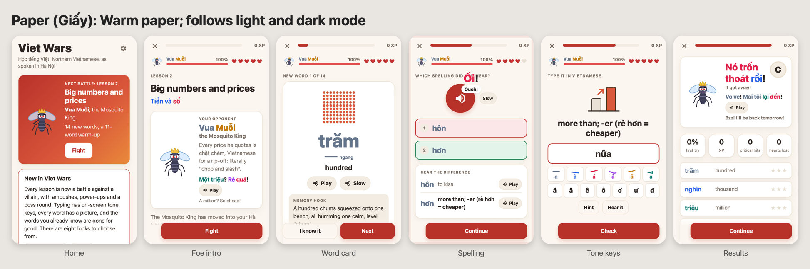
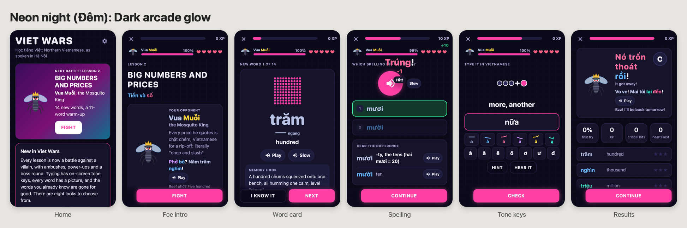
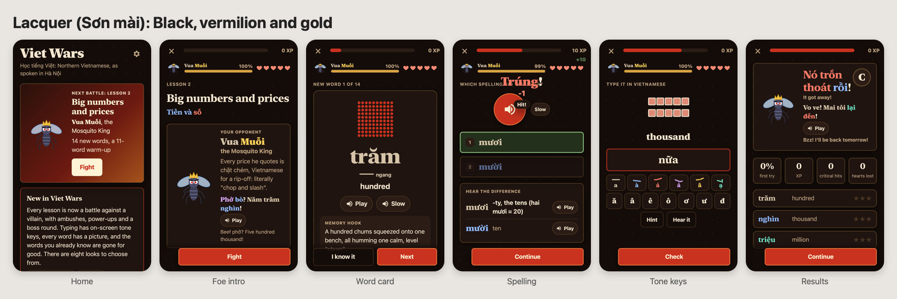
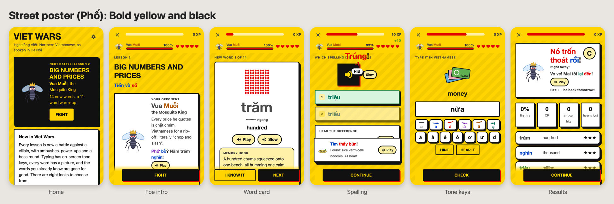
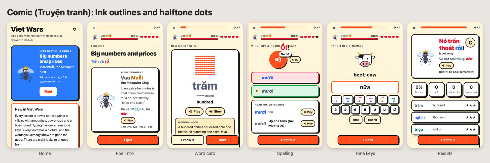
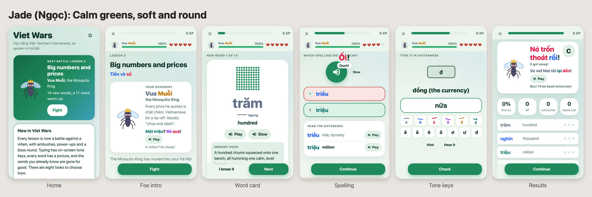
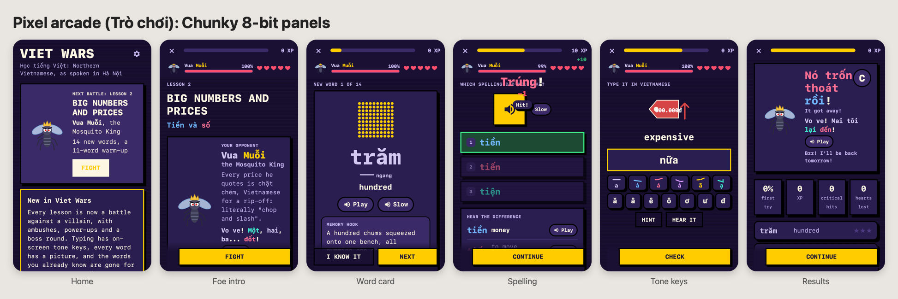
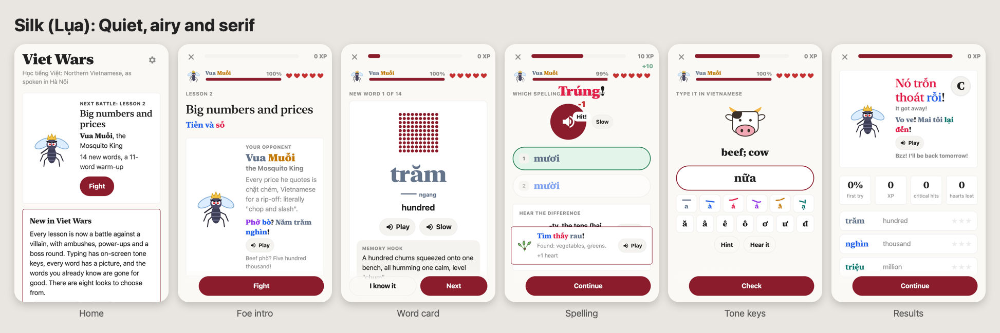

# Visual styles

Every style, rendered on an iPhone 15 screen by `scripts/style_shots.py`. Pick one in the app under Settings, Look; or preview one by adding `?style=<id>` to the address.

## Paper (Giấy)

`?style=paper`. Warm paper; follows light and dark mode.

## Neon night (Đêm)

`?style=night`. Dark arcade glow.

## Lacquer (Sơn mài)

`?style=lacquer`. Black, vermilion and gold.

## Street poster (Phố)

`?style=street`. Bold yellow and black.

## Comic (Truyện tranh)

`?style=comic`. Ink outlines and halftone dots.

## Jade (Ngọc)

`?style=jade`. Calm greens, soft and round.

## Pixel arcade (Trò chơi)

`?style=arcade`. Chunky 8-bit panels.

## Silk (Lụa)

`?style=silk`. Quiet, airy and serif.

