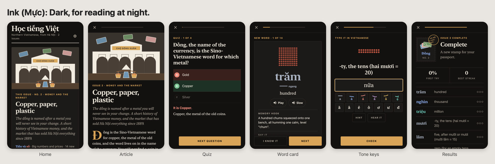
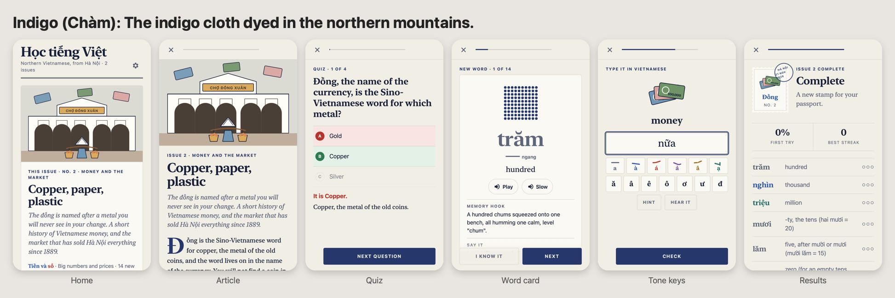
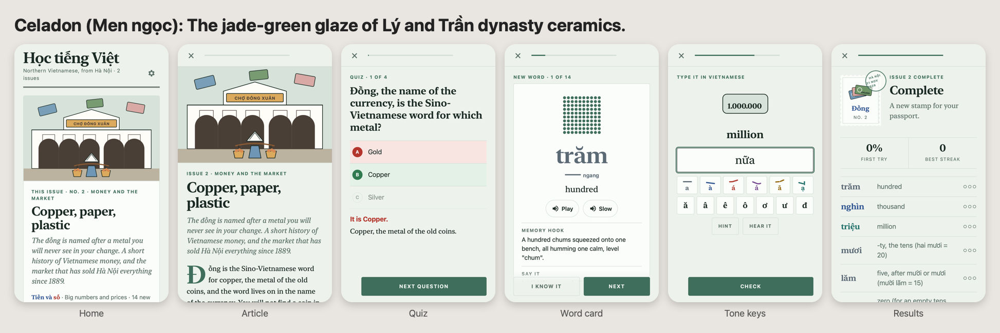

# Visual styles

Every style, rendered on an iPhone 15 screen by `scripts/style_shots.py`. Pick one in the app under Settings, Look; or preview one by adding `?style=<id>` to the address.

## Paper (Giấy dó)

`?style=paper`. The mulberry-bark paper of Đông Hồ woodblock prints. Follows light and dark mode..

## Ink (Mực)

`?style=ink`. Dark, for reading at night..

## Lacquer (Sơn mài)

`?style=lacquer`. Black, vermilion and gold, after Hà Nội lacquer painting..

## Indigo (Chàm)

`?style=indigo`. The indigo cloth dyed in the northern mountains..

## Celadon (Men ngọc)

`?style=celadon`. The jade-green glaze of Lý and Trần dynasty ceramics..

## Silk (Lụa)

`?style=silk`. Quiet, white and airy..

